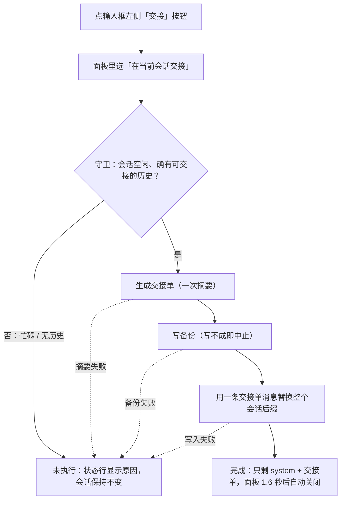

# 会话交接（handoff）

**用一次 LLM 摘要把整个会话后缀换成一份「交接单」，机制等价于上下文压缩。**

上下文快满时，`/compact` 会挑最旧的一段历史做通用 checkpoint、保留近期原文；交接不这么干：它把 system 之后
的**整个后缀**一次性换掉，只留 system、工作区指令和一份结构化的交接单。交接单是给**人和下一个模型**都能读的
阶段存档——目标、不变式、当前状态、关键决策、死路、下一步、指针，都按固定小节写明。它存在的理由是：
Agent 换人/换会话/换阶段时，需要的不是「压缩后的对话」，而是一页能复核、能接着干的交接材料。

这是本仓库的第二个 DSH 插件，包目录 `plugins/handoff/`。它**不替换**用户的压缩后端，只借用同一套
「摘要 + 替换后缀」机制自己走一遍；除 `/handoff` 命令外，只有一个只读草稿路由，不引入独立服务。
设计细节见 [design.md](./design.md)。

---

## 安装

构建产物 `index.js`、`client.js` 已随仓库提交，安装时不需要 clone、不需要在本机构建。

**DSH 侧栏 Plugins → Add plugin**，粘贴：

```
git+https://github.com/zh880517/dsh_plugins.git#main&path:/plugins/handoff
```

- `#main` 跟随主分支；要固定版本就换成 commit；
- `&path:/plugins/handoff` 指定包在仓库子目录里（一个仓库可以有多个插件，每个一条 spec）；
- 装完自动加入 profile 的 bundle 列表并启用，重开 DSH 生效。

升级没有原地升级：重新安装新的 commit（或先 Remove 再装）。

---

## 怎么用

两个入口，共用同一套守卫与摘要：

**输入框左侧的「交接」按钮**（只在有活会话的会话页出现；新会话首屏没有）打开面板，两项：

- **在当前会话交接**：用交接单替换整个会话后缀。客户端直接调用 `/handoff` 命令
  （`remote.commands.execute`），与手敲完全等价；不发 composer、不 submit、不经过斜杠菜单。
- **开启新会话交接**：向 Host 要一份只读草稿（`GET /handoff/draft`），新建会话、把交接单作为
  首条消息发进去，再切过去；旧会话一个字节不动。

**「在当前会话交接」的执行链路**（简化版，只画主干；每个守卫的完整文案与失败分支见
[design.md §3.1](./design.md)）：



**命令**：

```
/handoff
```

在要交接的会话里直接发这条命令。Host 会：

1. 守卫：轮次必须空闲、没有进行中的压缩、确有可遮蔽的历史；
2. 用会话前缀 + 交接单指令调一次 `ctx.llm.stream()`，生成交接单；
3. 先落备份，再 `append` 一条带 `surfaceOp: replace` 的 `user/message`；
4. 结果行告诉你「遮蔽 N 条、备份路径」。

两个入口共用上面这套守卫与摘要。命令的成功文案是固定的 `已交接：遮蔽 N 条，备份 <path>`，不附 token 数：
取 `tokenMeter` 需要 `import '@deepseek-ai/dsh-token-meter'`，被本仓库的层次约束（插件不得 import
`@deepseek-ai/*`）禁止，这是既定限制，不是待做项。

完成后当前会话只剩 system、工作区指令和交接单，原历史不再进入模型上下文；要看原文就去读备份文件。

新会话交接的 Host 端只有那个只读路由：不 append、不遮蔽、不建 session、不写备份。没有可交接的历史时
它返回 `doc: null` / `shadowable: 0`，面板就地提示，不会拿空文本去建新会话。草稿只服务已挂载的活跃会话；
冷会话（持久化但没在当前 DSH 里打开）返回 404，不 resume——resume 会挂载 Agent 并落事件，违反"草稿不写任何东西"。

---

## 会做什么

- **两个入口，一套核心**：`/handoff` 命令与输入框按钮共用守卫、摘要与交接单生成；按钮的就地交接只是
  把同一条命令交给客户端 `remote.commands.execute`，不另开通道。
- **新会话交接只读**：Host 只生成草稿，不碰旧会话；新会话由 Client 建，首条消息就是交接单。
- **整段交接**：把 `session.surface.nodes` 的全部后缀（system 之后、含所有消息与工具调用）替换成一条交接单，
  不留原文；替换区间天然是完整后缀，不会切断 tool call / result 配对。
- **生成结构化交接单**：`# 交接：<阶段名>` + 目标 / 不变式 / 当前状态 / 关键决策 / 死路 / 下一步 / 指针七个小节。
  纯模型生成，模板写不满也照原样输出，不做「降级成普通摘要」。
- **先备份，后替换**：备份是这一操作唯一的不可撤销写入，写不成就不 append（fail closed）。
- **报告结果**：成功/无历史/忙碌/会话变化/摘要失败/取消/备份失败/写入会话失败/兜底，各有明确文案，不静默失败。
  其中「无历史」按成功返回（`没有可交接的历史。`），备份已写后取消会附上备份路径，写入会话失败同样提示
  「会话未修改」并给出备份路径。

## 不会做什么

- **不替换压缩后端**：不实现 `CompactionEngine`，不接管 `ctx.compaction`，不顶掉 `compaction-basic`。
  两者的区别在范围、文档形态与触发方式：压缩挑最旧区间并保留近期原文、可被压力自动触发；交接只手动、整段替换。
- **不参与压缩锁**：不写 `compaction/start|summary|end` 事件；但**必须读**压缩的锁，进行中压缩时拒绝执行，
  以免和自动压缩撞车。
- **不可撤销**：替换后的对话上下文无法恢复，只能从备份文件回读原文；要保留现场就在执行前自己另存。
- **不做自动触发、不做 fork、不做「保留最近一轮」的中间挖段**。
- **不在轮次运行中执行**：有轮次正在跑或压缩正在进行时直接拒绝。
- **不 resume 冷会话**：草稿只服务已挂载的活跃会话，冷会话（持久化但没在当前 DSH 里打开）返回 404；
  要交接就先把它在 DSH 里打开。
- **不改会话日志文件**：只用 `Session.append` 写入，不直接动日志。

---

## 备份与数据

- 备份路径：`~/.dsh/handoff/<sessionId>-<yyyyMMdd-HHmmss>.md`，一次交接一个文件，内容就是完整的交接单；
- `HANDOFF_HOME` 环境变量可重定向备份根目录（测试用，避免污染真实 home）；
- 插件不另建数据库、不写会话日志；除备份文件外没有持久化数据；
- 备份目录不存在时自动创建；备份失败会中止交接并报错。

---

## 开发

```bash
npm install
npm run typecheck                 # shared + 所有插件
npm test                          # vitest（tests/handoff/）
npm run build -- --only handoff   # 生成 plugins/handoff/index.js 与 client.js（产物要提交）
npm run check:docs                # 文档目录与链接完整性
npm run check                     # typecheck + test + check:plugin + check:docs
```

Host 半依赖 DSH 的 `commands`、`sessions`、`llm`、`webServer` 服务；没有 Web 服务的组合（headless /
SDK-minimal）里插件不激活，`/handoff` 也随之消失。装到本机 profile 后，
改 Host 半需要让条目重新加载（`plugin_manager` 先关再开）；改 Client 半需要重新构建并重载条目。

---

## 文档

- 架构、流程与关键决策：[design.md](./design.md)
- 仓库文档规则与插件索引：[docs/README.md](../../README.md)
- 根目录插件表：[README.md](../../../README.md)
- 插件源码与包内短版说明：[plugins/handoff/README.md](../../../plugins/handoff/README.md)
