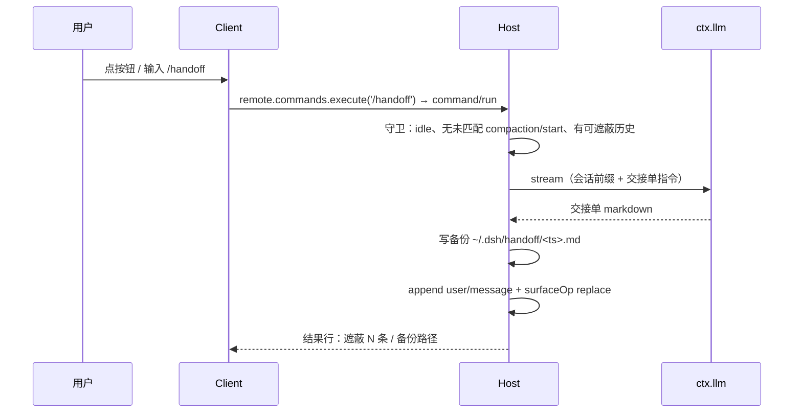
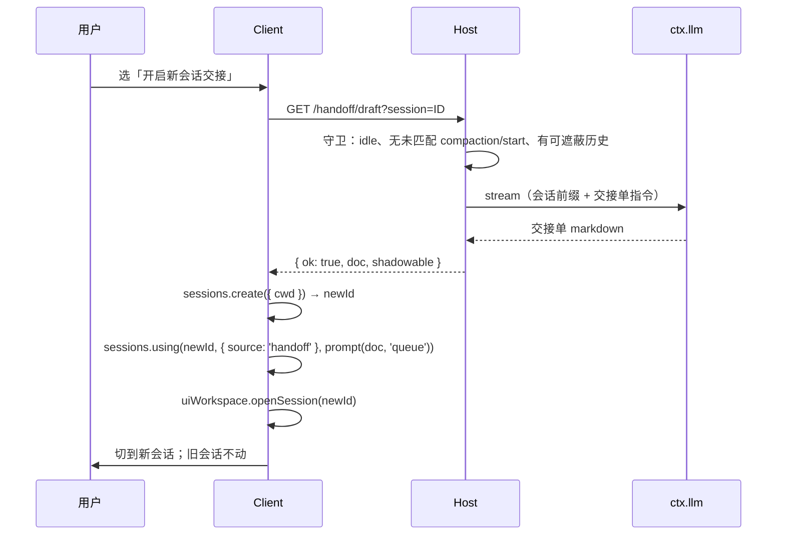

# 会话交接（Handoff）— 插件设计文档

日期：2026-10-30
状态：P1 已发布（`/handoff` 命令，0.1.0）；P2 已实现（输入框按钮 + `GET /handoff/draft`，111 个单测通过），待真机验收，版本待 bump 到 0.1.1
适用范围：`plugins/handoff/`（仓库内的一个插件包）
参考实现：`@deepseek-ai/dsh-compaction-basic`（摘要 + 替换）、`@deepseek-ai/dsh-command-compact`（`/compact` 命令）

---

## 1. 定位

**交接 = 一次摘要提示词换成"交接单"的压缩。** 不引入新机制：

- 摘要由一次 `ctx.llm.stream()` 调用产生，提示词换成交接单模板
- 落地就是一条带 `surfaceOp: replace` 的 `user/message`
- 入口与 `/compact` 同构：一条命令；另有输入框左侧的按钮，就地交接 / 新会话交接二选一

与压缩的区别只在**范围**和**文档形态**：

| | compaction | handoff |
|---|---|---|
| 范围 | 最旧的平衡区间，保留近期原文（`retainRatio` 0.16） | **整个后缀**（保留 system + 工作区指令），不留原文 |
| 摘要内容 | 通用 checkpoint，面向"无损续跑" | 交接单，面向"人可读、可复核的阶段存档" |
| 触发 | 压力阈值自动 + `/compact` 手动 | 只手动 |
| 事件 | 写 `compaction/start|summary|end`，参与锁 | **不写** `compaction/*`，不参与压缩锁 |

**为什么不复用 `CompactionEngine`：** 一个 context 只能挂一个 `ctx.compaction`，子类化并挂载会把用户原有的压缩后端顶掉，卸载后压缩就没了。我们要"并存"，所以自己走一遍摘要 + append，代价是抄约 30 行守卫（§4.4）。

## 2. 两个入口，一套核心

```
输入框「交接」按钮（`conversation.input.left`）
  ├─ 在当前会话交接 ──→ ctx.remote.commands.execute(sessionId, '/handoff', [])
  └─ 开启新会话交接 ──→ GET /handoff/draft?session=<id>
                          → ctx.sessions.create({ cwd })
                          → ctx.sessions.using(newId, { source: 'handoff' }, ref =>
                              ref.binding.session.prompt([{ type: 'text', text: doc }], 'queue'))
                          → ctx.uiWorkspace.openSession(newId)
```

- **就地交接走客户端命令通道**：`remote.commands.execute` 与斜杠菜单落到同一条 Host `command/run`；Host 不需要为它加路由。按钮不写 composer、不 submit。
- **新会话交接必须由 Client 做**（切会话是客户端职责）；Host 只多一个只读的 `GET /handoff/draft`
- **不做预览弹窗**：`/compact` 也没有预览，两者同构。结果行报告"遮蔽 N 条、备份路径"，需要复核就读备份文件

## 3. 核心流程

### 3.1 就地交接（`/handoff`）



### 3.2 新会话交接



新会话模式下 Host **不写任何东西**：不 append、不遮蔽、不建 session、不写备份。Client 侧四步顺序固定：

1. `GET /handoff/draft?session=<id>` 拿交接单与 `shadowable`；
2. `ctx.sessions.create({ cwd })` 建新会话，拿到 `newId`；
3. `ctx.sessions.using(newId, { source: 'handoff' }, ref => ref.binding.session.prompt([{ type: 'text', text: doc }], 'queue'))` 把交接单作为首条消息发进去；
4. `ctx.uiWorkspace.openSession(newId)` 切过去。

任何一步失败都留在原会话、不切走（`prompt` 失败时已建出的新会话不自动删除）。`create` 不接受 prompt，依据见 §5.5。

### 3.3 `GET /handoff/draft` 契约

`GET /handoff/draft?session=<sessionId>`。路由按 `kind: 'prefix'` 注册在插件命名空间 `/handoff` 下，端点本身是 `/handoff/draft`（`/handoff/draft/` 等价，其下的其它路径回 404 `not-found`）；只支持 GET，`OPTIONS` 回 204，其余方法 405。

| 情形 | 状态码 | 响应体 |
|---|---|---|
| 成功 | 200 | `{ ok: true, doc: "<交接单>", shadowable: 4 }` |
| 无历史 | 200 | `{ ok: true, doc: null, shadowable: 0 }` |
| 缺 session 参数 | 400 | `{ ok: false, error: { code: 'bad-request', message: '…' } }` |
| 找不到活跃会话 | 404 | `{ ok:false, error:{ code:'session-not-found', … } }` |
| 忙 | 409 | `{ ok:false, error:{ code:'busy', … } }` |
| 会话在但 agent 不活跃 | 409 | `{ ok:false, error:{ code:'agent-not-live', … } }` |
| 摘要失败 | 502 | `{ ok:false, error:{ code:'summary-failed', … } }` |
| 兜底 | 500 | `{ ok:false, error:{ code:'internal', … } }` |

- **Client 必须以 `doc === null` / `shadowable === 0` 判断"不要建新会话"**：这是成功响应里的"无历史"，不是错误；空字符串 `doc` 也按无历史处理。
- **只服务已挂载的活跃会话**：`ctx.sessions.get(id)` 只覆盖 live session；冷（持久化但未挂载）会话返回 404。不 resume 的理由：resume 会挂载 Agent 并落事件，违反"草稿不写任何东西"。
- 取 agent 用 `ctx.get('agents').get(id)`（与 aiworkflow 同款），不伪造 agent；拿不到 agents 服务或没有 live agent 时返回 409 `agent-not-live`。
- 与命令路径的差异：draft **不做选区稳定校验**。新会话只消费这份文本、旧会话一个字节没动；`/handoff` 要拿同一份文档去 replace，快照与区间不一致会遮蔽错东西，所以稳定性检查只在命令路径。
- 客户端断开时 `res.on('close')` 触发 `AbortController`，信号传给摘要；已经断开就不再写响应。Host 内部会产出 499 `cancelled`，但客户端已断开时这个响应写不回去（保留完整结果只为单测与日志）。
- 其它 HTTP 细节：CORS 放行 `*`（桌面壳 `file://` 的页面源是 `null`），响应带 `cache-control: no-store`。

## 4. Host 实现

### 4.1 入口与注册

```ts
// src/host.ts
export const inject = ['commands', 'sessions', 'llm', 'webServer'];

export function apply(ctx: any): void {
  const active = new Set<Promise<unknown>>();
  const track = <T>(operation: Promise<T>): Promise<T> => {
    active.add(operation);
    const retire = () => active.delete(operation);
    operation.then(retire, retire);
    return operation;
  };
  ctx.effect(function* () {
    yield async () => { await Promise.allSettled(active); };
    yield ctx.commands.register({
      definitionId: '@handoff/dsh-plugin',
      name: 'handoff',
      description: 'Replace this conversation with a handoff document',
      handler: (invocation: Invocation) => track(runHandoff(ctx, invocation)),
    });
  }, 'handoff lifecycle');

  ctx.effect(() => {
    const disposeRoute = ctx.webServer.register({
      kind: 'prefix',
      path: '/handoff/draft',
      handler: (req, res) => handleDraftRequest(ctx, req, res, track),
    });
    return () => { disposeRoute(); };
  }, 'handoff draft route');
}
```

形状照抄 `dsh-command-compact`：`active` 集合保证插件卸载时等所有进行中的交接结算。`definitionId` 用完整包名（与 DSH 自家命令一致），`name` 才是用户敲的 `/handoff`。路由只负责 HTTP（CORS / 状态码 / JSON / 客户端断开），业务在 `src/draft.ts`；`agents` 不写进 `inject`，走 `ctx.get('agents')`，缺它时命令照常、draft 返回 409。

**`webServer` 的副作用要记住：** `inject` 里有 `webServer` 之后，没有 Web 服务的组合（headless / SDK-minimal）里插件不再激活，`/handoff` 命令也随之消失。这是当前设计接受的取舍：按钮与草稿路由只存在于 Web 与桌面壳，这些组合本来也用不上按钮。

### 4.2 摘要

关键技巧直接沿用压缩后端（`summarizeWithLlm`）：

1. **把指令作为最后一条 user 消息追加到回放前缀之后**，而不是单独一套 summarizer 系统提示词——这样这次调用是上一次请求的真前缀，provider 的 KV cache 可复用
2. 目标模型取 `agent.session.requestHeader()?.config`，取不到再退 `agent.options.{provider,model}`
3. 走 `ctx.llm.stream`，`purpose` 复用 `'compaction'`（避免新增枚举成员）
4. 输出为空文本 → 抛错，不产生交接单

```ts
const HANDOFF_INSTRUCTION = `You are a handoff engine. Condense the conversation ABOVE into a handoff document
that lets another model resume the work, and that a human can review later.
Output EXACTLY this Markdown structure, keeping every section (write "(none)" when empty):

# 交接：<阶段名>
## 目标
## 不变式
## 当前状态
## 关键决策
## 死路
## 下一步
## 指针

Preserve exact file paths, commands, error strings, identifiers and numbers.
Do not mention this summary request. Output only the document; do not call tools.`;
```

### 4.3 替换

```ts
const nodes = [...session.surface.nodes];          // seq 数组，模型可见顺序
const pinned = pinnedNodeCount(session, nodes);    // 至少 1（system），见 §9 V1
const shadowed = nodes.slice(pinned);
if (shadowed.length === 0) return { kind: 'success', text: '没有可交接的历史。' };

await writeBackup(ctx, doc, { sessionId, startSeq: shadowed[0], endSeq: shadowed.at(-1) });

session.append('user/message',
  { id: randomUUID(),                              // 必须，见下方说明
    role: 'user', source: { kind: 'user' },
    content: [{ type: 'text', text: `${PREAMBLE}\n\n<handoff>\n${doc}\n</handoff>` }] },
  { surfaceOp: { op: 'replace', startSeq: shadowed[0], endSeq: shadowed.at(-1) },
    sourceEventSeqs: shadowed });                   // 必须覆盖每一个被遮蔽节点
```

**为什么必须带 `id`：** `Session.append` 自己不校验 payload 里的 `id`，但会话恢复路径 `dsh-session-persistence` 的 `validateStoredEvents` → `adoptSessionEvent` → `assertMessageEventShape` 要求 `user/message` 的 `message.id` 是非空字符串，否则报 `"...lacks an identified message"`。省掉 `id` 的后果不是这次 append 报错，而是**这个会话下次加载失败**。实现用 `node:crypto` 的 `randomUUID()` 生成，与 `dsh-llm` 的 `createUserMessage` 一致。

**为什么安全：** `shadowed` 是 surface 的**后缀**，所有 tool call / result 对都完整落在区间内，不可能切断配对，因此不需要 `toolPairingBalancedBefore/After`。

**为什么先写备份：** 这是唯一不可撤销的写操作；备份写不成就不 append（fail closed）。

### 4.4 守卫

| 检查 | 实现 | 失败文案 |
|---|---|---|
| agent 空闲 | 从 `session.seq - 1` 往前扫，遇到 `turn/start` 而未见 `turn/end` → busy | `当前有轮次正在运行或压缩正在进行，交接暂不可用。` |
| 无进行中压缩 | 从 `session.seq - 1` 往前扫 `compaction/start` / `compaction/end`，有未匹配 start → busy；**只看最新 `session/end-seed` 之后的事件**（见下） | 同上 |
| 选区稳定 | 摘要完成后重读 `session.surface.nodes`，与快照不一致 → changed | `交接期间会话发生了变化，未执行。请重试。` |
| 有可交接历史 | `shadowed.length > 0` | `没有可交接的历史。` |

**命令执行时没有开着的 turn（已实证，守卫 A 不需要放宽）。** 原本担心"handler 自己就在一个 `turn/start` 里跑，严格判定会永远返回忙碌"。真实数据排除了这一点：

- 扫了 278 份会话日志（`~/.dsh/sessions/**`，zstd 多帧），找到 7 次 `/compact`（唯一的真实命令），**每一次 `command/run` 时的 turn 深度都是 0**；紧邻前一条是 `turn/end`，其中一次是 `session/end-seed`。
- 代码侧印证：`@deepseek-ai/dsh-commands` 的 `execute()` 注释原文 **"Both are direct log-only appends — no turn wraps them"**；`command/run` 在 handler 之前、`command/done` 在其之后。

典型序列（session-c59b7bd0），命令整段落在第 12 轮 `turn/end` 与第 13 轮 `turn/start` 之间：

```text
4444 turn/end      {"turn":12,"reason":{"kind":"completed"}}
4445 command/run   {"commandId":"cmd-210d5414-2","name":"compact","args":"","source":{"kind":"user"}}
4446 compaction/start
4447 compaction/summary
4448 user/message   （replace 3758..4438，source.kind = compact-checkpoint）
4449 compaction/end
4450 command/done   {"kind":"success","text":"Compacted 358 history items (~133695 tokens).","sourceEventSeq":4447}
4451 agent/inbox/spliced
4452 turn/start     {"turn":13}
```

- 结论：严格 `inspectBusy(...) !== 'idle'` 成立，无需放宽；用户在轮次运行中发 `/handoff` 会如实拿到忙碌文案（符合 §7）。
- 补充细节：只有 `command/done` 可能落在下一轮 `turn/start` 之后，`command/run` 从不——不影响在 run 时刻的判定。

**扫描边界：只看最新 `session/end-seed` 之后的事件。** 忙碌判定里的"未配对标记"都以最新一条 `session/end-seed` 为下界：早于它的未配对 `compaction/start` 不算活跃。这条例外来自宿主的两处行为：

- `dsh-session` 的 `buildForkSeed`（`lib/index.js:927-936`）只闭合 turn，**不闭合 compaction**，所以从"压缩进行中"的会话 fork 出来的新会话，其种子事件里会留下一个永远等不到 `compaction/end` 的 `compaction/start`；
- `dsh-compaction-basic` 的 `assertCompactionInactive`（`lib/index.js:536-539`）正是这样判定的：未配对 start 若早于最新 `session/end-seed` 就不算活跃；`inspectCompactionEntryState`（`:706-734`）也顺带找出 `latestEndSeedSeq`。

不按这个边界判定时，真实后果是：从压缩中的会话 fork 出的新会话会**永久**返回忙碌，文案还是误导性的"轮次正在运行或压缩正在进行"。`turn/start` 的判定沿用同一边界；fork 会闭合 turn（`buildForkSeed`），所以实践中不会在 end-seed 之前留下未配对的 turn，但扫描逻辑统一从最新 `session/end-seed` 之后开始。

不写锁事件：我们不进压缩的锁；但**必须读**压缩的锁，否则会和自动压缩撞车。

### 4.5 结果文案

| 情形 | 文案 |
|---|---|
| 成功 | `已交接：遮蔽 N 条，备份 <path>` |
| 无历史 | `没有可交接的历史。` |
| 忙碌 | `当前有轮次正在运行或压缩正在进行，交接暂不可用。` |
| 会话变化 | `交接期间会话发生了变化，未执行。请重试。` |
| 摘要失败 | `交接单生成失败（模型未返回有效内容），未执行。` |
| 备份失败 | `备份写入失败，未执行交接。` |
| 取消（备份前） | `交接已取消。` |
| 取消（备份已写后） | `交接已取消。（交接单已备份到 <path>，会话未修改）` |
| append 失败 | `交接单写入会话失败（<原因>），会话未修改；备份见 <path>` |
| 兜底 | `交接未执行：<原因>。` |

命令返回 `{ kind: 'success' | 'error', text, sourceEventSeq? }`；`sourceEventSeq` 取 append 后的事件 seq，供 UI 定位。

**无历史是成功而不是失败：** 该情形返回 `{ kind: 'success', text: '没有可交接的历史。' }`，与 `/compact` 的 "No compactable history yet." 同构。其余失败与取消（含备份已写后的取消、append 失败、兜底）都是 `kind: 'error'`。

**兜底文案**覆盖 surface / 事件读取等意外路径：任何未在表格里收敛的异常都在 `runHandoff` 外层折成 `交接未执行：<原因>。`，不向命令层抛未捕获异常。

**成功文案不带 token 数：** 要拿 `tokenMeter` 必须 `import '@deepseek-ai/dsh-token-meter'`，被本仓库的层次约束（插件不得 import `@deepseek-ai/*`）禁止，所以 P1 明确不做"约 X token"，这是既定限制而不是待做项。成功文案就是 `已交接：遮蔽 N 条，备份 <path>`。

## 5. Client 实现

### 5.1 入口按钮

- 插槽 `conversation.input.left`（`kind: 'list'`、`scope: 'session'`），注册 `{ name, id: 'handoff', order: 30, locale: 'handoff' }`；slot id 与 locale 命名空间都是 `handoff`。
- 渲染为 28×28 圆形图标按钮（14px 内联 SVG）：底色 `--dsw-specific-selector`，hover 用 `--dsw-alias-interactive-bg-hover-solid`，`disabled` 时 `opacity: .5`。
- **该插槽只在有活会话时渲染**：新会话首屏（hero / workspace picker）没有输入框工具行，因此也没有交接按钮。这是宿主行为，不是插件的降级或遗漏。

### 5.2 运行时依赖

- `inject: ['slots', 'locale', 'remote', 'remote.commands', 'sessions', 'uiWorkspace']`
- `package.json` 的 `dsh.client.inject` 只声明 `["@deepseek-ai/dsh-client-ui-conversation"]`：它表达的是对提供会话输入区插槽的那个包的加载依赖，不是对宿主内部的依赖。

### 5.3 面板

`shell.overlay` 浮层（注册 id `handoff-panel`、`order: 80`）：标题 +「在当前会话交接」+「开启新会话交接」两项 + 一行状态（idle 不占位 / pending 带转圈 / 结果着色）。

- Esc 关闭；点浮层外部关闭（透明 backdrop 只负责接点击）。
- 就地交接成功后就地生效，面板保留 1.6s 展示确认文案，再自动关闭。
- 进行中可以关闭：关闭会 abort 在飞的 draft 请求（Host 收到 `close` 后中止摘要）。就地命令无法 abort——它已经进了 Host 的命令通道，Host 会继续跑完，只是结果没人展示。

### 5.4 就地交接

链路是一条命令调用，**不写 composer、不 submit、不经过斜杠菜单**：

```ts
const outcome = await ctx.remote.commands.execute(sessionId, '/handoff', []);
// 成功：{ ok: true, value: { commandId, result: { kind, text? } } }
// 失败：{ ok: false, error: { message } }
```

- 展示 `value.result.text`（Host 中文原样；成功 / 忙碌 / 无历史 / 会话变化都是这句）。`value === undefined` 按"未知命令"处理。
- 这与宿主自己的 `ui-plan` 按钮发 `/plan off` 的用法同款（`dsh-client-ui-plan/lib/client.js:700-709`）。
- **副作用（要记住）**：`command/run` 的 `source` 由命令层硬编码为 `{ kind: 'user' }`，程序化触发与手打 `/handoff` 在日志里不可区分，审计不能靠 `source` 判断是谁发起的。忙闲守卫对按钮同样生效：轮次运行中（或压缩进行中）点按钮会拿到和手敲一样的忙碌文案，不会插队。

### 5.5 新会话交接

四步，顺序固定；`ctx.sessions.create` 不接受 prompt（§9 V3 已结案）：

1. `GET /handoff/draft?session=<id>` 拿只读交接单；`doc === null` / `shadowable === 0` → 提示"没有可交接的历史"并停在原会话，不建新会话。
2. `const newId = await ctx.sessions.create({ cwd })`。`sessions.create` 只接受 `{ workspaceId, cwd, sessionId, agentPreset }`，**没有 prompt 字段**（`dsh-api-session-controller` 的 `lib/types/client/sessions/manager.js:443`）。
3. 借一个已 retain 的会话引用发首条消息：

   ```ts
   await ctx.sessions.using(newId, { source: 'handoff' }, (reference) =>
     reference.binding.session.prompt([{ type: 'text', text: doc }], 'queue'));
   ```

   `using` 见 `.../client/sessions/service.js:204`，`reference.binding.session` 见 `:472`，`prompt(content, mode)` 见 `.../client/sessions/session.js:171`。`{ source: 'handoff' }` 标明这次借用来自交接，第二个参数 `'queue'` 是投递模式。
4. `ctx.uiWorkspace.openSession(newId)`（`dsh-client-ui-workspace/lib/client.js:1471`）切过去。

任何一步失败都留在原会话、不切走；`prompt` 失败时已建出的新会话不自动删除。旧会话一个字节都不动。

### 5.6 i18n

- 运行时字典在 `src/i18n.ts`：`ctx.locale.register(NS, locale, dict)`（`NS = 'handoff'`，`locale` 为 `en` / `zh` / `zh-CN` / `zh-Hans`），对重复注册容错；当前语言缺键时退回中文，不把 key 甩给用户。
- `locale/zh.json`、`locale/en.json` **不是**运行时字典：它们只有市场卡片用的 `meta.title` / `meta.description`，由 `dsh-app-boot` 扫描读取；运行时文案一律走 `ctx.locale`。
- Host 返回的文案（`CommandResult.text`、草稿路由的 `error.message`）一律中文原样展示，不在客户端二次翻译，避免英文界面出现"Host 中文 + 插件英文"混排。

### 5.7 样式与构建约束

- 样式在 `src/styles.tsx`，类名统一 `hpf-` 前缀，颜色 / 圆角 / 阴影全用宿主 CSS 变量（`--dsw-*`），明暗主题自动跟随；样式随组件挂载，不向 `document` 追加节点。
- **不加宿主 primitives**：`scripts/build-plugin.mjs` 只外置 `react` / `react-dom` / `react-dom/client`，import `@deepseek-ai/dsh-client-ui-primitives` 会构建失败，所以按钮和面板都是手写 DOM + 宿主变量。

## 6. 交接单

```markdown
<!-- handoff: <id> at <ISO> from session <id> (seq a..b) -->
# 交接：<阶段名>
## 目标          一句话 + 可执行的验收命令
## 不变式        不许改的接口 / 文件 / 行为
## 当前状态      已完成（带证据）/ 未完成
## 关键决策      为什么选 A 不选 B
## 死路          试过 X，失败原因 Y
## 下一步        具体到文件与命令
## 指针          产物路径、日志路径、原会话 id
```

- **纯模型生成，失败即失败**：模板写不出"下一步"，降级会让人误以为交接成功了
- 备份：`~/.dsh/handoff/<sessionId>-<yyyyMMdd-HHmmss>.md`；`HANDOFF_HOME` 可重定向（测试用）
- 替换消息的 `source` 用 `{ kind: 'user' }`，不发明新的 kind
- `GET /handoff/draft` 返回的 `doc` 就是同一份完整交接单（含上面的头部注释），Client 原样作为新会话首条 prompt

## 7. 边界

- 不实现 `CompactionEngine`，不替换 `compaction-basic`
- 不写 `compaction/*` 事件，不参与压缩锁（但读）
- 不改会话日志文件，只用 `Session.append`
- 草稿路由只读：不 append、不遮蔽、不建 session、不写备份
- 草稿只服务已挂载的活跃会话，不 resume 冷会话（resume 会挂载 Agent 并落事件）
- 新会话交接不触碰旧会话；新会话是另一份 session
- 不做自动触发、不做 fork、不做"保留最近一轮"的中间挖段
- 不支持在轮次运行中执行

### 已知技术债：`session.eventAt()` 已废弃

`dsh-session` 已把 `eventAt()` 标为 `@deprecated`（"new calls are prohibited"）。P1 仍在用它读 surface 节点（`surfaceViews`）与读全量事件（`eventViews`）；两处都已收在 `src/handoff.ts` 的内部函数里。将来替换成 `session.snapshotEvents(fromSeq, toSeqExclusive)` 只改这两处，其余代码不受影响。

## 8. 包结构

```
plugins/handoff/
  package.json          # name/version/exports/files/dsh.bundle.patch/dsh.client
  cordis.patch.yml      # - insert: [{ id: handoff, name: '@handoff/dsh-plugin' }]
  tsconfig.json         # extends ../../tsconfig.plugin.base.json, include: ["src"]
  market.json           # 市场展示元数据
  README.md             # 短版，链到 docs/plugins/handoff/
  icon.svg              # 入口按钮与市场卡片图标
  locale/
    zh.json             # 只有 meta.title / meta.description（市场卡片）
    en.json             # 同上
  src/
    host.ts             # 入口：inject / apply / 命令与路由注册、生命周期
    command.ts          # /handoff 处理器：守卫 → 摘要 → 备份 → 替换 → 文案
    handoff.ts          # 两条入口共用核心：视图类型、surfaceViews/eventViews、HANDOFF_TEXTS、buildHandoffDoc、prepareHandoff
    draft.ts            # 草稿：与 /handoff 同款守卫与摘要 → { doc, shadowable } 或 HTTP 错误
    summarize.ts        # HANDOFF_INSTRUCTION + ctx.llm.stream 封装
    core.ts             # 纯逻辑：pinnedNodeCount / shadowedRange / inspectBusy（可单测）
    backup.ts           # ~/.dsh/handoff/ 落盘
    client.tsx          # 浏览器半入口：按钮 + 面板容器 + 请求状态
    panel.tsx           # 面板展示层（纯 props，可静态渲染）
    actions.ts          # 两条动作链：就地 execute / 新会话 create → prompt → openSession
    logic.ts            # 纯逻辑：classifyCommand / classifyDraft / PanelStatus
    i18n.ts             # 运行时字典（en / zh / zh-CN / zh-Hans）
    styles.tsx          # hpf- 前缀样式，全用宿主 --dsw-* 变量
    endpoint.ts         # 数据端点解析（同源优先，桌面壳退 __DSH_TRANSPORT__）
  index.js client.js    # 构建产物，必须提交
```

| 项 | 值 |
|---|---|
| 包名 | `@handoff/dsh-plugin`，版本 `0.1.0`（P2 待 bump 到 `0.1.1`） |
| 路由 | `GET /handoff/draft`（只读，`kind: 'prefix'` 注册） |
| 命令 | `/handoff` |
| Slot | 入口 `handoff` @ `conversation.input.left`（`order: 30`）；面板 `handoff-panel` @ `shell.overlay`（`order: 80`） |
| 测试 | `tests/handoff/`：`core` / `backup` / `summarize` / `command` / `draft` / `client-logic` / `client-actions` / `client-apply` / `panel-render` |

## 9. 实现中要顺手验证的四个点

| # | 问题 | 在哪里观察 | 影响 |
|---|---|---|---|
| V1 | 工作区指令基线（一条 `user/message`，节点 1 附近）被遮蔽后，`dsh-agent-instructions` 会不会自动重注？ | **已确认/结案**（`~/.dsh/sessions` 的会话日志） | `pinnedNodeCount` 保守取"1 + 前导注入节点"成立，不需要改 |
| V2 | 已连接的客户端在 replace 后会不会自动刷新会话视图？ | T4 | 不会则提示"请刷新" |
| V3 | `sessionManager.create` 是否支持首条 prompt，字段名是什么？ | **已确认/结案**（T9/T10） | 不支持；`create` 只接受 `{ workspaceId, cwd, sessionId, agentPreset }`，首条 prompt 走 `ctx.sessions.using(...)` 的 `reference.binding.session.prompt(...)`，见 §5.5 |
| V4 | `ctx.llm.stream` 的 `purpose: 'compaction'` 在被当成"交接"调用时有无副作用 | T3 | 无副作用就复用 |

V1 已结案：真实日志里工作区指令基线就是一条 `source.kind: "agent-instructions"` 的 `user/message`（例：session-c59b7bd0 的 seq 10），`pinnedNodeCount` 的前导注入判定与真实形状一致；标准会话 surface 的头部是 system + 注入节点，`shadowedRange` 不会吃掉 system 头。保守实现（保留 system + 前导注入节点）成立，不需要改。V3 已结案（见上）；V2 随 T4 真机验收记录；V4 在 T3 落地为复用 `purpose: 'compaction'`。

## 10. 任务拆分

### P1 — 就地交接可用（可独立发布）

| # | 任务 | 产出 | 完成标准 | 依赖 | 状态 |
|---|---|---|---|---|---|
| T1 | 包骨架 | `package.json`、`cordis.patch.yml`、`tsconfig.json`、`market.json`、`README.md`、`src/host.ts`、`src/client.tsx` 入口 | `npm run typecheck` 通过；`npm run build -- --only handoff` 产出 `index.js`/`client.js` | — | 已完成 |
| T2 | 纯逻辑 `core.ts` | `pinnedNodeCount`、`shadowedRange`、`inspectBusy`（输入：事件类型与 seq 的只读视图） | `tests/handoff/core.test.ts` 覆盖：system 保留、注入节点跳过、后缀范围、busy 三态（idle / 开轮 / 未匹配压缩） | T1 | 已完成 |
| T3 | 摘要 `summarize.ts` | 指令常量 + `stream` 封装 + 空文本抛错 | 假 llm 单测：拼接顺序正确（前缀 + 指令）、空输出抛错 | T1 | 已完成 |
| T4 | 命令 `command.ts` | `/handoff` 全流程 | 真机在长会话执行：结果行正确、会话只剩 system + 交接单、日志可回放、UI 表现记录（V1/V2） | T1 T2 T3 T5 | 实现完成，待真机验收 |
| T5 | 备份 `backup.ts` | 落盘 + `HANDOFF_HOME` | 单测：路径格式、目录不存在时自建、写失败抛错 | T1 | 已完成 |
| T6 | 文档补全 | `docs/plugins/handoff/README.md`、`plugins/handoff/README.md`、根 README 与 `docs/README.md` 各一行链接 | `npm run check:docs` 通过（不再报孤儿目录） | T1 | 已完成 |
| T7 | 收尾 | 版本 0.1.0、构建产物提交、市场索引刷新 | `npm run check` 四项全绿 | T2–T6 | 已完成 |

### P2 — 按钮与新会话（P1 发布后）

| # | 任务 | 产出 | 完成标准 | 依赖 | 状态 |
|---|---|---|---|---|---|
| T8 | draft 路由 | `GET /handoff/draft?session=`，`inject` 加 `webServer` | 返回 `{ doc, shadowable }`；忙/空历史走同一守卫 | T4 | 已完成（已实现，待真机验收） |
| T9 | 输入框按钮与面板 | `conversation.input.left` 按钮 + `shell.overlay` 面板 + `i18n.ts` + locale 文件 | 点「就地」走 `remote.commands.execute('/handoff')`；点「新会话」走 T10 | T1 | 已完成（已实现，待真机验收） |
| T10 | 新会话模式 | 草稿 → `sessions.create` → `using(prompt)` → `openSession` | 新会话首条即交接单；旧会话不被触碰；V3 已结案 | T8 T9 | 已完成（已实现，待真机验收） |
| T11 | 发布 0.1.1 | 版本 bump、构建、文档、市场 | `npm run check` 全绿 | T8–T10 | 未完成（版本仍 0.1.0，待 bump 到 0.1.1 并发布） |

### 顺序与并行

```
T1 ──┬─ T2 ─┐
     ├─ T3 ─┼─ T4 ─┬─ T6 ─ T7
     └─ T5 ─┘      │
                   └─ T8 ─┬─ T10 ─ T11
                   T9 ────┘
```

T2/T3/T5 互不依赖，可并行；T4 是第一个真机验收点，也是 V2 的观察点（V1 已结案，不再是观察点）。
